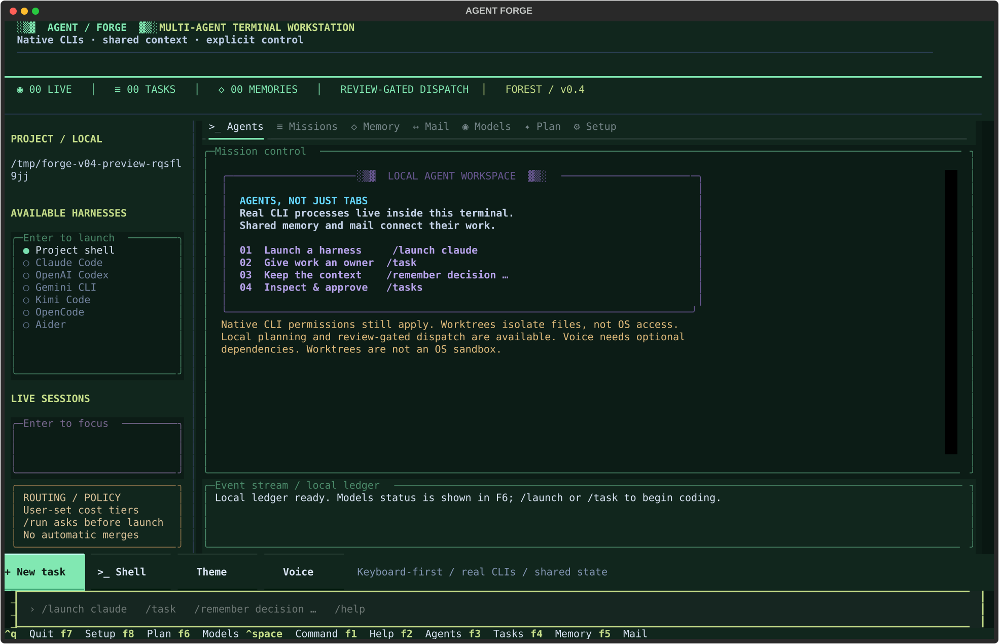
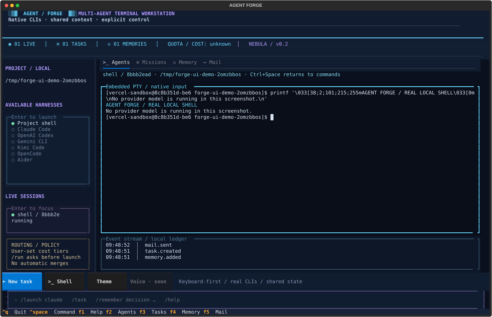
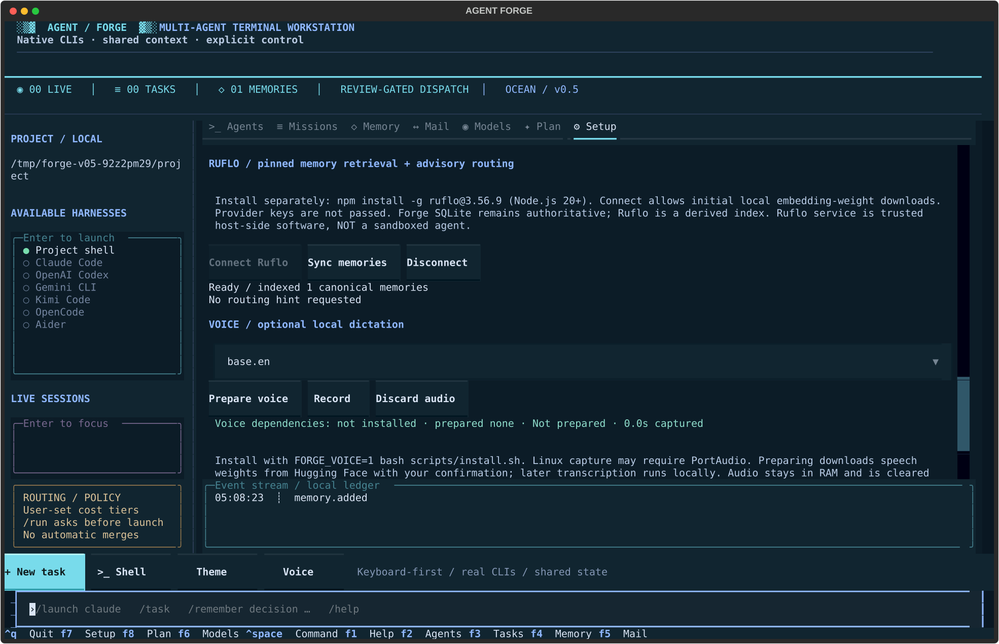
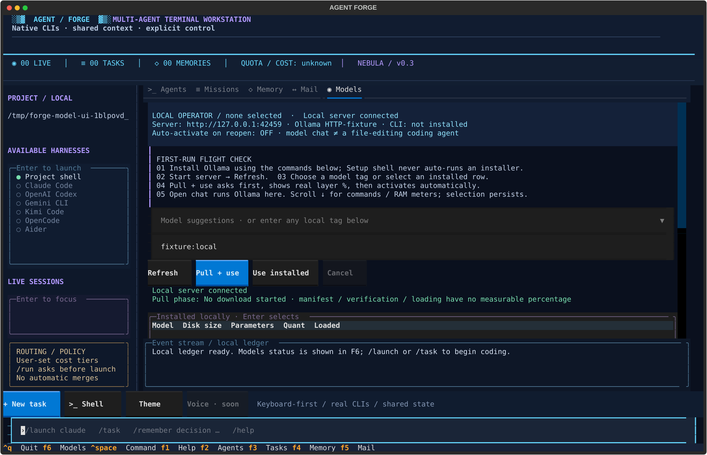

# Agent Forge

### Your agent workspace. Entirely inside the terminal.

**A full-screen, Claude-Code-style TUI — not Electron, not a browser, and not a pile of detached terminal windows.** Real coding CLIs run inside embedded terminal surfaces, with one shared project store for memory, missions, and agent mail.



> v0.5 development build: pinned live Ruflo memory/routing bridge, Linux/WSL folder enforcement, native Windows ConPTY/installer source and automatic Windows/Linux validation. Windows CI evidence and native Windows isolation are separate gates; see [checklist](docs/CHECKLIST.md).


## Start

Python **3.11+**, Git, and a UTF-8 terminal. **Linux / WSL** use POSIX PTYs. **Native Windows 10 1809+ / Windows 11** has a ConPTY backend and PowerShell installer; real Windows validation is recorded separately, not simulated by Linux tests. macOS still needs device validation. Enforced folder isolation currently requires Linux/WSL Bubblewrap.

```bash
git clone https://github.com/HIDORAKAI002/agent-forge.git
cd agent-forge
FORGE_VOICE=1 bash scripts/install.sh
export PATH="$HOME/.local/bin:$PATH"
agent-command --project /path/to/your/project
```

Native Windows installation from an authorized checkout:

```powershell
./scripts/install.ps1 -Voice
# Open a new terminal, then:
agent-command --project C:\path\to\project
```

The Windows installer adds the user-local command directory to the user PATH unless `FORGE_CONFIGURE_PATH=0`. It does not silently change PowerShell execution policy or install system prerequisites. Standard npm shims resolve to native Node entrypoints so generated task text is not evaluated through `cmd.exe`; other batch shims require an explicitly configured native executable.

`agent-command` is a **placeholder launch name**, not the final brand. Set `FORGE_COMMAND=my-command` during installation to choose another valid name. The installer uses `~/.local/share/agent-forge/venv` and `~/.local/bin` by default, without sudo. It copies the package, so the checkout is not a runtime dependency. `FORGE_INSTALL_ROOT` / `FORGE_BIN_ROOT` override the install locations. To omit voice dependencies, leave out `FORGE_VOICE=1`. Python 3.11+ and system audio libraries remain prerequisites.

The installer adds a managed PATH block to supported bash/zsh profiles after backing up existing files; disable this with `FORGE_CONFIGURE_PATH=0`. The current shell still needs the printed `export PATH=...` command or a new terminal. It refuses to overwrite an unrelated launch command. Update by pulling the source and rerunning the installer. It does not silently install provider CLIs, Ollama, Docker or system packages.

**This repository is private:** clone using your existing authorized GitHub login. An anonymous public installer is not available from this private repo. A public binary/package distribution is a separate release decision. For development/testing, use a virtual environment and `pip install -e '.[mcp,credentials,test]'`. A 120×40 terminal or larger is recommended; 100×36 has a compact layout.

Already inside a project? `forge` uses the current directory. `forge --project /path doctor` prints detected CLI harnesses without opening the TUI. The app does not install or authenticate providers automatically.

## The interface

- **Eight themes:** Nebula, Ember, Forest, Ocean, Sakura, Solar, Glacier and Graphite with terminal-native borders, stippled textures, tabbed views, and a bottom command deck.
- **Setup (F7):** masked keys, routing, themes, voice, reviewed folder permissions and pinned Ruflo controls.
- **Plan (F8):** local supervisor draft → human queue approval → authorized bounded dispatch.
- **Agents:** real CLI terminal surfaces; select a session and type directly. `Ctrl+C` reaches the focused CLI.
- **Missions:** guided task editor, a dependency-aware ledger, isolated Git worktrees, and explicit launch/review confirmations.
- **Memory:** project facts, decisions, and handoffs with author/time/trust provenance.
- **Models (F6):** local Ollama library/installed-tag selection, actual streamed download layer %, model activation, RAM/VRAM residency and a persistent first-run guide.
- **Mail:** durable project-local inboxes with explicit acknowledgment.
- **Live status:** actual session/task/memory counts. Provider quota tracking is intentionally out of scope.
- **Keyboard-first:** slash commands, command history, engine/session pickers, F-key tabs, and `Ctrl+Space` back to the composer.



## Provider setup and local supervision

First launch opens **Setup**. Choose Claude, Codex or Gemini, enter a masked key and choose **session-only** or **OS credential store**. **Install CLI** shows the official Claude/Codex/Gemini install command and asks before running it in an embedded terminal. Codex/Gemini npm installation requires Node.js/npm already present; the wizard never silently runs sudo or system package installers. Saving a key does not validate it or make a model request. Keys never enter project memory, SQLite events, preferences, command history or command-line arguments. Only approved OS-vault backends are accepted; there is no plaintext-file fallback. Headless Linux commonly has no unlocked vault: use session-only storage or native CLI login. Keys are passed only to corresponding provider processes; restart existing sessions to apply changes. Provider/enterprise authentication policies still apply.

Claude may ask to approve the configured API key. Gemini uses `GEMINI_API_KEY`. Codex requires its authentication flow; **Codex auth** explicitly feeds the saved key through an un-echoed pipe and requires an OS vault for its cache. Native CLI login remains an alternative. A subscription login and an API key are not interchangeable, and API use may incur charges. Other CLI providers use their native setup until a specific authentication adapter is verified.

In **Models**, activate an installed local Ollama operator. In **Plan**, enter a goal and choose **Make plan**. The selected local model receives the goal and recent memory reference data, not an unrestricted copy of the entire filesystem. It returns a validated, editable task DAG. **Queue draft** shows routed engines and asks before creating tasks; it does not launch CLIs.

Choose each installed coding engine's tier in **Setup**. High-risk tasks prefer `strong`; routine tasks prefer `local`, then `free`, `economy`, `unknown`, `strong`. High-risk fallback order is shown in the source policy. A `free` label is your classification, **not proof that a provider charges nothing**. Live provider quota tracking is intentionally removed from required scope.

**Dispatch** asks for approval of up to 20 queued tasks and then starts ready work automatically, with at most two task sessions. CLI command changes revoke queued permissions. Tasks still require human review, and prerequisite changes must be merged manually before dependent work. **Pause** cancels future launch grants but does not stop already running CLIs. No automatic retries or merges occur. Use session stop controls to stop active processes.

A selected local model also creates an **Aider local coder** profile: `aider --model ollama_chat/MODEL`. Install Aider separately using its [official instructions](https://aider.chat/docs/llms/ollama.html). That profile can perform coding tasks in worktrees; the standalone Ollama chat profile cannot edit files by itself. Automatic commits are disabled and native confirmations remain enabled. Actual model/harness combinations need real-device validation.

## Folder permissions and Ruflo

Open **Setup → Permissions** or `/sandbox`. Review and confirm:

- The selected project is the only **persistently writable** host folder.
- Separately approved reference/runtime directories are mounted **read-only**.
- Other user directories are absent from the sandbox; symlinks do not grant access to hidden targets.
- Git control metadata is read-only to agents; Forge Git helpers run inside the same boundary with hooks/fsmonitor disabled.
- Standard `/usr`, `/bin`, `/sbin`, `/lib`, `/lib64` runtime trees and selected certificate/resolver configuration are read-only exceptions. Disposable temporary HOME/tmp are writable. Host procfs is not mounted.
- Network is blocked by default. Allowing networking permits the **host network**, including local Ollama; it is not a provider-domain-only firewall.
- Inherited SSH sockets, unrelated API keys and startup environment hooks are removed. Only the selected engine's managed credentials are passed in its process environment—not command arguments.

Install **Bubblewrap** using your distribution's official packages first. Install Forge outside the writable project and explicitly approve any additional user-local CLI/package directories needed as read-only runtime grants. OAuth/cache behavior and CLI combinations need compatibility testing; there is no silent unsandboxed fallback. Permissions affect **new sessions only** and clear future dispatch grants. Existing sessions retain their launch policy, shown per session. Native Windows/macOS enforcement is **not implemented**; ConPTY is a terminal backend, not isolation.

For the optional Ruflo integration:

```bash
npm install -g ruflo@3.56.9
```

Choose **Connect Ruflo** in Setup, then **Sync memories** or `/ruflo search QUERY`. The version is checked before use. Connecting authorizes initial local embedding downloads. This is trusted host-side software, not a sandboxed agent; provider keys and SSH sockets are not inherited. Forge SQLite is authoritative; Ruflo stores a derived index in trusted per-project user configuration outside the writable project. Retrieved IDs are rehydrated from current Forge records, never trusted as independently verified content.

When connected, **Make plan** retrieves relevant memories and obtains an advisory `hooks_model-route` hint before calling the selected Ollama planner. Ruflo's hint does not override user engine tiers or authorize paid calls. Forge still performs real CLI dispatch and review gates. No Ruflo browser/federation/autopilot executors are enabled. Some upstream orchestration endpoints only schedule records; we do not present that as actual agent execution. This is a defined memory/routing integration, **not every Ruflo feature imported wholesale**.



## Voice typing

Install with `FORGE_VOICE=1 bash scripts/install.sh`, then open **Setup → Voice**. Select a speech model and choose **Prepare voice**; initial weight download is confirmed separately. Press **Record**, speak, then **Stop + transcribe**. CPU/int8 faster-whisper generates an editable draft. Choose insertion into the planning goal, composer, or active CLI. **No Enter is sent and no command is auto-executed.**

Audio is held in RAM, capped at 60 seconds and cleared after processing/discard. Speech model weights stay in the user cache; the first download requires network. Installer/model-loading progress is indeterminate rather than a made-up percentage. Linux may require PortAudio; device access/permissions are user-controlled. This is in-app dictation, not a system-wide hotkey service. Actual tiny.en CPU/int8 transcription and the Forge prepare → RAM audio → editable-draft pipeline were tested with the public whisper.cpp JFK sample. Microphone device behavior still requires testing.

## Quick workflow

```text
/launch claude
```

Launches the installed `claude` process inside the TUI. Existing CLI login and permissions remain with that CLI. `codex`, `gemini`, `kimi`, `opencode`, `aider`, and `shell` have built-in interactive profiles. Availability comes from PATH.

```text
/remember decision Run the parser test suite before merging changes.
/task
```

`/task` opens a terminal-native editor. Creating a task only queues it. `/run TASK_ID` asks before starting a CLI in an isolated worktree from committed HEAD. The project must be the Git repository root and tracked/untracked changes must be committed or stashed first.

An agent exit code of zero means **needs-review**, not “correct.” Inspect the worktree diff, run the required checks, and use `/approve TASK_ID` to record human approval. **Approval does not merge work.** Integrate prerequisite changes manually before dependent implementation tasks.

Automated task argument templates currently exist for Claude (`-p`), Codex (`exec`), and Gemini (`-p`). They are version-sensitive and need actual-provider validation. Other built-in CLIs are interactive-only until their automation interface is verified. No permission-bypass flags are added.

## Ollama / local operator

The first launch automatically opens **Models** with a project-local tutorial. Press **F6** or `/models` anytime. `/tutorial` reopens the guide; **Finish / skip tutorial** hides it without installing anything.

1. **Install Ollama** using the visible platform instructions. Linux / WSL:
   ```bash
   curl -fsSL https://ollama.com/install.sh | sh
   ```
   Review the installer before running it. macOS: use the official installer at https://ollama.com/download. **Setup shell** opens a real shell but never types or executes an installer. No fictional installation percentage is shown.
2. **Start server** launches the installed `ollama serve` inside a real embedded terminal, bound to the configured loopback endpoint. If Ollama already runs as a service, just **Refresh**.
3. **Choose a tag**, e.g. `qwen2.5-coder:1.5b`, `qwen2.5-coder:3b`, or `qwen2.5-coder:7b`; any valid local tag works. Enter on an installed table row copies its tag into the selector. Model size comes from the server, not an invented RAM guarantee.
4. **Pull + use** asks permission for the network/download and RAM load. Forge streams `/api/pull`, verifies the model appears in the local inventory, preloads it and verifies `/api/ps` before saving the selected operator. **Use installed** skips the download.
5. **Open chat** embeds the actual `ollama run MODEL` process. This is a local conversation, **not an autonomous coding harness**: selecting a model does not grant file-editing tools or enable supervisor planning.

The chosen operator persists in `.agent-forge/ollama.json`. Once explicitly activated, an installed selection preloads automatically on project reopen when the local Ollama server is reachable. Start the server through the guide if it is not already running. A missing selection is **never auto-downloaded**. **Unload** sets keep-alive to zero and turns off automatic activation, preserving the selection. Server keep-alive after activation is five minutes; Ollama may evict models sooner under memory pressure. Auto-activation happens on reopen, not continuous GPU pinning.

### Honest progress and resource meters

- The percentage and bar are **current-layer bytes completed / layer total**, not a fabricated whole-model percentage. Known-layer bytes are summed separately; new layers can increase the known denominator.
- Manifest lookup, integrity verification, installer execution and RAM loading have **no measurable percentage** and are labeled indeterminate. A layer reaching 100% does not mean activation is complete.
- Host RAM percentage/free GB is actual `psutil` data. Project-filesystem free space is labeled separately and is not assumed to be Ollama's model-storage disk.
- Loaded model bytes and VRAM bytes come from `/api/ps`. **GPU residency %** means `size_vram / size`, not GPU compute utilization or a GPU memory-capacity percentage.
- Cancel stops local stream consumption and prevents committing a new selection. An accepted Ollama server operation may finish independently; inspect server status. Cancelling does not promise to reclaim cached blobs.

`OLLAMA_HOST` defaults to `http://127.0.0.1:11434`. Only loopback HTTP endpoints (`localhost`, `127.0.0.1`, `::1`) are accepted. API requests bypass environment proxies and refuse redirects. Models with remote/cloud metadata and explicit cloud tags are excluded. Downloading still contacts Ollama's registry; **local generation is not offline installation**. Ollama and its model licenses are separate from this repository.

Official references: [Linux setup](https://docs.ollama.com/linux), [streamed pull](https://docs.ollama.com/api/pull), [installed inventory](https://docs.ollama.com/api/tags), [loaded models](https://docs.ollama.com/api/ps), [preload / unload](https://docs.ollama.com/api/generate), [Qwen2.5-Coder tags](https://ollama.com/library/qwen2.5-coder).



## Command deck

| Command / key | Action |
|---|---|
| `/setup`, F7 | Provider keys, themes, routing and voice setup |
| `/plan [GOAL]`, F8 | Local supervisor proposal |
| `/dispatch`, `/pause` | Authorize bounded ready-task dispatch / stop future launches |
| `/voice` | Jump to local dictation setup |
| `/models`, F6 | Local model hub |
| `/tutorial` | Reopen first-run guide |
| `/ollama pull MODEL`, `/ollama use MODEL` | Confirm download or installed activation |
| `/ollama refresh`, `chat`, `serve`, `setup`, `unload`, `cancel` | Ollama lifecycle controls |
| `/launch ENGINE` | Embed a real CLI |
| `/focus SESSION_ID` | Return to a session; IDs accept unique prefixes |
| `/sessions`, `/engines` | Inspect sessions or configured harnesses |
| `/stop SESSION_ID` | Confirm cleanup of the session and known descendants |
| `/task` | Guided mission editor |
| `/task ENGINE TITLE :: INSTRUCTIONS` | Queue a bounded task |
| `/tasks`, `/run TASK_ID` | Inspect or explicitly launch work |
| `/approve TASK_ID` | Record human review; no merge |
| `/remember KIND TEXT` | Add a human-submitted verified fact/decision/handoff |
| `/memory [QUERY]` | Inspect/filter shared memory |
| `/send FROM TO TEXT` | Send durable project-local mail |
| `/inbox NAME` | Select an agent inbox |
| `/ack FULL_MESSAGE_ID RECIPIENT` | Acknowledge handled mail |
| `/route routine` or `/route high` | Recommend a user-configured tier; never auto-dispatch |
| `/theme NAME` | Select one of eight saved palettes |
| `/help`, F1 | Open the command deck |
| F2 / F3 / F4 / F5 | Agents / missions / memory / mail |
| Ctrl+Space | Return to slash-command input |
| Ctrl+Q, `/quit` | Confirm stopping active sessions and exit |
| Y / N / Esc in a confirmation | Explicit accept / reject; Cancel is the safe default |

## Shared project memory and agent tools

```
project/.agent-forge/
  state.sqlite           # canonical memory, task/mail/event ledger
  memory.md              # generated readable summary, latest 500 records
  workspace.lock         # one active TUI owns a project
  ollama.json            # selected local operator, auto-activation, tutorial state
  profiles.json          # optional custom CLI/model profiles
  worktrees/<task-id>/    # preserved task workspaces
```

Add `.agent-forge/` to your project's `.gitignore` if appropriate. Initialization deliberately does not rewrite your repository configuration, CLAUDE.md, AGENTS.md or GEMINI.md.

Every agent can contribute through the shared CLI:

```bash
forge --project /absolute/project/path memory list --query parser
forge --project /absolute/project/path memory add \
  --kind handoff --author codex --text 'Changed the parser; test results attached.'
```

Task prompts include current shared context and this contribution path. Interactive CLIs are not magically forced to use it: attach the shared MCP server or configure project instructions explicitly.

### MCP

Configure each compatible CLI using its official stdio-MCP settings. Use the **absolute installed Python path**:

```json
{
  "command": "/absolute/path/to/.venv/bin/python",
  "args": ["-m", "forge", "--project", "/absolute/project/path", "mcp"]
}
```

Tools: `memory_search`, `memory_add`, `task_list`, `message_send`, `message_inbox`, `message_ack`.

Independent clients share the same SQLite database. Agent entries are always **unverified**. Author/sender/recipient labels are self-reported routing labels, not cryptographic identities. Human TUI submissions are marked verified by explicit submission, not by an automated truth checker. All agents attached to a project share one local trust boundary. Mail requires polling; delivery does not silently inject text into another agent's terminal.

## Custom CLIs, DeepSeek/Kimi models and routing

A **model is not a CLI harness**. Use a supported harness that exposes the desired provider/model through its documented configuration, or register a trusted custom command. Do not assume a separate official CLI exists for every model vendor.

Create `.agent-forge/profiles.json`, for example:

```json
[
  {
    "id": "local-worker",
    "label": "My local coding worker",
    "argv": ["/absolute/path/to/my-worker"],
    "task_argv": ["/absolute/path/to/my-worker", "--prompt", "{prompt}"],
    "tier": "local"
  },
  {
    "id": "claude",
    "label": "Claude Code / primary",
    "argv": ["claude"],
    "task_argv": ["claude", "-p", "{prompt}"],
    "tier": "strong"
  }
]
```

This is a schema example: `my-worker` must actually exist and implement the arguments. Commands are argv arrays, not shell-evaluated strings. Reload the app after configuration changes. Credentials belong in provider-managed authentication or your process environment, never in memory or profile files.

`/route` prioritizes local/economy tiers for routine tasks and strong tiers for high-risk work. **This is a transparent, user-configured recommendation policy, not an automatic planner, live-price router, budget enforcer or guarantee of free usage.** Built-in tiers default to unknown until configured.

## Safety and compatibility

- **OFF mode is unrestricted.** Worktrees alone are not a sandbox. Linux/WSL Bubblewrap is an explicit, reviewed option with documented runtime/tmp exceptions; native Windows/macOS isolation is missing.
- No paid-model dispatch without approval, automatic merges/pushes, unconfirmed provider installation or remote listener. External provider/Ruflo dependencies retain their own behavior and policies.
- Only use trusted projects and CLIs. A custom executable/profile is executable code, not a safe document.
- Terminal output is rendered through a VT emulator, not written directly into the parent terminal; OSC clipboard/link escape sequences are not executed by the renderer. Full modern terminal protocol coverage is not guaranteed.
- Cursor movement, truecolor/ANSI styles, resize, UTF-8 input, standard control/navigation keys, bracketed paste and primary/alternate screen handling are implemented. Advanced mouse reporting, Kitty graphics/keyboard extensions, sixel and advanced scrollback navigation are not implemented. ConPTY source is added and requires native Windows acceptance evidence.
- Ctrl+Q, F1–F8 and Ctrl+Space are reserved by the host. They are not passed through to a focused CLI. Avoid putting secrets into command history, tasks, mail, memory or screenshots.
- A dedicated, single-threaded PTY broker avoids forkpty from the multi-threaded TUI. Stop terminates known descendants and escalates if necessary. Malicious or independently detached processes can escape lifecycle tracking; this is not a security boundary.
- Memory, tasks and mail persist locally; live terminal sessions do not resume after app restart. Interrupted tasks are marked failed and never rerun automatically. Existing worktrees are preserved for manual inspection.
- The Markdown file is a derived projection. A crash can make it temporarily stale; SQLite remains authoritative and reopening regenerates it. Symlink checks at managed entry points do not eliminate local filesystem races.

## Development / validation

```bash
pip install -e '.[mcp,test]'
python -m pytest -q
python scripts/capture_tui.py
python scripts/capture_ollama.py
python scripts/capture_v04.py
python scripts/capture_v05.py
```

**v0.5 automated validation is recorded in [VALIDATION.json](docs/VALIDATION.json)**, including the original terminal/memory/MCP regressions, Ollama fixtures, credential scoping, routing, planner/dispatch, dictation drafts and installer guards. Fifteen v0.4 TUI states were visually inspected individually: setup, provider controls, all eight themes, planner preview, queue approval, voice controls, a real public-sample transcription draft and compact 100×36 setup. Planner screenshots are labeled fixtures, not model-generated evidence. Five v0.5 states were inspected separately, including a real Ruflo MCP connection and SmartRetrieval result.

The tests cover persistent memory, concurrent writers, dependencies, mail acknowledgment, project ownership, real Linux PTY input/controlling TTY, resize, cancellation, parallel **fixture** agents in worktrees, alternate screens, explicit routing policy, guided TUI editing, keyboard focus, compact layout, and **two actual stdio MCP clients**.

Ollama tests use a real loopback HTTP fixture server with streamed NDJSON, error/EOF/cancellation cases, persisted activation, auto-resume, remote/cloud rejection and TUI confirmations. No real Ollama model was downloaded or inferred here.

No provider account or real Claude/Codex/Gemini model was used in these tests. Those compatibility checks are the next milestone. `requirements-lock.txt` records the tested environment; the editable project itself is installed separately. The capture script exports nine actual Textual screen states; a local shell is real, while demo memory/task/mail records are explicitly labeled.

## Next build steps

1. Validate installed Claude/Codex/Gemini/Kimi/Aider and Ollama model versions, permissions and real-device behavior.
2. Harden the implemented supervised planner/dispatcher with real-model evaluations and acceptance checks.
3. Attach project memory/mail MCP automatically only with consent, preserving existing provider configuration.
4. Extend the implemented pinned Ruflo memory/routing bridge only after auditing additional modules; no competing authorities.
5. Keep provider quota tracking out of required scope; retain explicit paid-task authorization and honest user-defined tier labels.
6. Validate the implemented optional local dictation on microphone devices; improve speech-model/device selection and accessibility.
7. Verify native Windows ConPTY/installer CI; implement native Windows isolation, improve protocol/accessibility/backups and packaging.

## Design references and license

The terminal UX direction follows the user's [AI Video Dubbing](https://github.com/HIDORAKAI002/ai-video-dubbing) Textual studio: live workspace, side rail, and bottom slash-command input. This implementation is original; it does not include the unrelated dubbing pipeline or the earlier Electron prototype.

External references, **not vendored** (Ruflo memory/routing adapter is implemented): [Ruflo](https://github.com/ruvnet/ruflo), [Handy](https://github.com/cjpais/Handy), [Agent Client Protocol](https://github.com/agentclientprotocol/agent-client-protocol), [Beads](https://github.com/gastownhall/beads).

Original code: MIT. Dependencies and any future speech models retain their own licenses; notably, pyte is LGPLv3 and is separately installed. See [third-party notices](docs/THIRD_PARTY.md) before bundling a distribution. Do not copy GPL/AGPL voice-app source into a differently licensed distribution without reviewing the obligations.

Native Windows/Linux/Ruflo CI records are published automatically to the `validation` branch under `docs/ci/`. Check `source_commit` against the desired release; an older pass is not evidence for a newer commit. Device, provider-account and security limitations remain in [CHECKLIST.md](docs/CHECKLIST.md).
