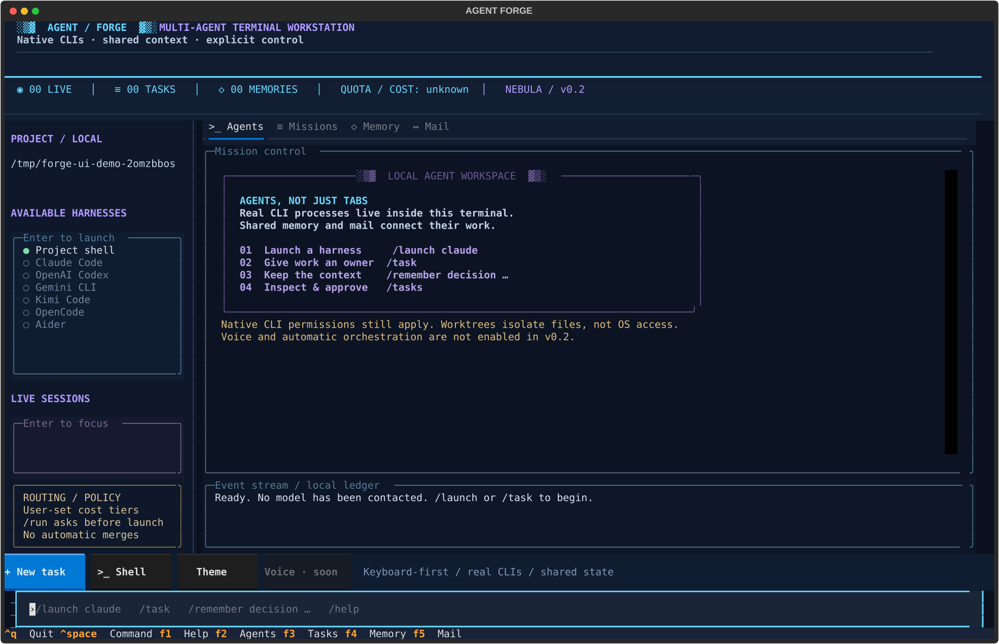

# Agent Forge

### Your agent workspace. Entirely inside the terminal.

**A full-screen, Claude-Code-style TUI — not Electron, not a browser, and not a pile of detached terminal windows.** Real coding CLIs run inside embedded terminal surfaces, with one shared project store for memory, missions, and agent mail.



> **v0.5 development build.** Local models, real CLI terminals, review-gated planning/worktrees, project memory/mail, optional local dictation, and reviewed upstream Ruflo tools are implemented. Linux/WSL has tested folder enforcement. **Native Windows filesystem enforcement is experimental and not release-ready.** See [current acceptance](docs/CURRENT_ACCEPTANCE.md) and [readiness checks](docs/READINESS.md), rather than treating screenshots or catalog counts as proof. Screenshots may contain explicitly labeled fixtures.

## Start

Python **3.11+**, Git, and a UTF-8 terminal. Linux/WSL uses POSIX PTYs; native Windows uses ConPTY and the [PowerShell installer](docs/INSTALL_BUNDLE.md), without WSL. macOS terminal/device behavior still needs acceptance testing. Terminal support is not filesystem isolation: Windows enforcement remains disabled by default, and macOS enforcement is unavailable.

```bash
git clone https://github.com/HIDORAKAI002/agent-forge.git
cd agent-forge
python3 -m venv .venv
source .venv/bin/activate
pip install -e '.[mcp]'
forge --project /path/to/your/project
```

This repository is private: clone using your existing authorized GitHub login. For development/testing, install `.[mcp,test]` instead. A 120×40 terminal or larger is recommended; 100×36 has a compact layout.

Already inside a project? `forge` uses the current directory. `forge --project /path doctor` prints detected CLI harnesses without opening the TUI. `doctor --full` provides read-only dependency checks; optional `--probe-ollama --require local_coding` checks the local service/model and Aider prerequisites, without generating text or reading keys. `/doctor` is also available inside the app. See [readiness checks](docs/READINESS.md). The app does not install or authenticate providers automatically.

## The interface

- **Eight palettes**, including cyan/violet Nebula and amber/rose Ember, with terminal-native borders, tabbed views, and a bottom command deck.
- **Agents:** real CLI terminal surfaces; select a session and type directly. `Ctrl+C` reaches the focused CLI.
- **Missions:** guided task editor, a dependency-aware ledger, isolated Git worktrees, and explicit launch/review confirmations.
- **Memory:** project facts, decisions, and handoffs with author/time/trust provenance.
- **Models (F6):** local Ollama library/installed-tag selection, actual streamed download layer %, model activation, RAM/VRAM residency and a persistent first-run guide.
- **Mail:** durable project-local inboxes with explicit acknowledgment.
- **Live status:** actual session/task/memory counts. Unknown quota/cost is labeled unknown, not invented.
- **Keyboard-first:** slash commands, command history, engine/session pickers, F-key tabs, and `Ctrl+Space` back to the composer.


## Quick workflow

```text
/launch claude
```

Launches the installed `claude` process inside the TUI. Existing CLI login and permissions remain with that CLI. `codex`, `gemini`, `kimi`, `opencode`, `aider`, and `shell` have built-in interactive profiles. Availability comes from PATH.

```text
/remember decision Run the parser test suite before merging changes.
/task
```

`/task` opens a terminal-native editor. Creating a task only queues it. `/run TASK_ID` asks before starting a CLI in an isolated worktree from committed HEAD. The project must be the Git repository root and tracked/untracked changes must be committed or stashed first.

An agent exit code of zero means **needs-review**, not “correct.” Inspect the worktree diff, run the required checks, and use `/approve TASK_ID` to record human approval. **Approval does not merge work.** Integrate prerequisite changes manually before dependent implementation tasks.

Automated task argument templates currently exist for Claude (`-p`), Codex (`exec`), and Gemini (`-p`). They are version-sensitive and need actual-provider validation. A configured Aider + Ollama coding profile has also passed one bounded real-file smoke test. Other built-in CLIs are interactive-only until their automation interface is verified. No permission-bypass flags are added.

## Ollama / local operator

The first launch automatically opens **Models** with a project-local tutorial. Press **F6** or `/models` anytime. `/tutorial` reopens the guide; **Finish / skip tutorial** hides it without installing anything.

1. **Install Ollama** using the visible platform instructions. Linux / WSL:
   ```bash
   curl -fsSL https://ollama.com/install.sh | sh
   ```
   Review the installer before running it. macOS: use the official installer at https://ollama.com/download. **Setup shell** opens a real shell but never types or executes an installer. No fictional installation percentage is shown.
2. **Start server** launches the installed `ollama serve` inside a real embedded terminal, bound to the configured loopback endpoint. If Ollama already runs as a service, just **Refresh**.
3. **Choose a tag**, e.g. `qwen2.5-coder:1.5b`, `qwen2.5-coder:3b`, or `qwen2.5-coder:7b`; any valid local tag works. Enter on an installed table row copies its tag into the selector. Model size comes from the server, not an invented RAM guarantee.
4. **Pull + use** asks permission for the network/download and RAM load. Forge streams `/api/pull`, verifies the model appears in the local inventory, preloads it and verifies `/api/ps` before saving the selected operator. **Use installed** skips the download.
5. **Open chat** embeds the actual `ollama run MODEL` process. This is a local conversation, **not an autonomous coding harness**: selecting a model does not grant file-editing tools or enable supervisor planning.

The chosen operator persists in `.agent-forge/ollama.json`. Once explicitly activated, an installed selection preloads automatically on project reopen when the local Ollama server is reachable. Start the server through the guide if it is not already running. A missing selection is **never auto-downloaded**. **Unload** sets keep-alive to zero and turns off automatic activation, preserving the selection. Server keep-alive after activation is five minutes; Ollama may evict models sooner under memory pressure. Auto-activation happens on reopen, not continuous GPU pinning.

### Honest progress and resource meters

- The percentage and bar are **current-layer bytes completed / layer total**, not a fabricated whole-model percentage. Known-layer bytes are summed separately; new layers can increase the known denominator.
- Manifest lookup, integrity verification, installer execution and RAM loading have **no measurable percentage** and are labeled indeterminate. A layer reaching 100% does not mean activation is complete.
- Host RAM percentage/free GB is actual `psutil` data. Project-filesystem free space is labeled separately and is not assumed to be Ollama's model-storage disk.
- Loaded model bytes and VRAM bytes come from `/api/ps`. **GPU residency %** means `size_vram / size`, not GPU compute utilization or a GPU memory-capacity percentage.
- Cancel stops local stream consumption and prevents committing a new selection. An accepted Ollama server operation may finish independently; inspect server status. Cancelling does not promise to reclaim cached blobs.

`OLLAMA_HOST` defaults to `http://127.0.0.1:11434`. Only loopback HTTP endpoints (`localhost`, `127.0.0.1`, `::1`) are accepted. API requests bypass environment proxies and refuse redirects. Models with remote/cloud metadata and explicit cloud tags are excluded. Downloading still contacts Ollama's registry; **local generation is not offline installation**. Ollama and its model licenses are separate from this repository.

Official references: [Linux setup](https://docs.ollama.com/linux), [streamed pull](https://docs.ollama.com/api/pull), [installed inventory](https://docs.ollama.com/api/tags), [loaded models](https://docs.ollama.com/api/ps), [preload / unload](https://docs.ollama.com/api/generate), [Qwen2.5-Coder tags](https://ollama.com/library/qwen2.5-coder).


## Command deck

| Command / key | Action |
|---|---|
| `/models`, F6 | Local model hub |
| `/tutorial` | Reopen first-run guide |
| `/ollama pull MODEL`, `/ollama use MODEL` | Confirm download or installed activation |
| `/ollama refresh`, `chat`, `serve`, `setup`, `unload`, `cancel` | Ollama lifecycle controls |
| `/launch ENGINE` | Embed a real CLI |
| `/focus SESSION_ID` | Return to a session; IDs accept unique prefixes |
| `/sessions`, `/engines` | Inspect sessions or configured harnesses |
| `/stop SESSION_ID` | Confirm cleanup of the session and known descendants |
| `/task` | Guided mission editor |
| `/task ENGINE TITLE :: INSTRUCTIONS` | Queue a bounded task |
| `/tasks`, `/run TASK_ID` | Inspect or explicitly launch work |
| `/approve TASK_ID` | Record human review; no merge |
| `/remember KIND TEXT` | Add a human-submitted verified fact/decision/handoff |
| `/memory [QUERY]` | Inspect/filter shared memory |
| `/send FROM TO TEXT` | Send durable project-local mail |
| `/inbox NAME` | Select an agent inbox |
| `/ack FULL_MESSAGE_ID RECIPIENT` | Acknowledge handled mail |
| `/route routine` or `/route high` | Recommend a user-configured tier; never auto-dispatch |
| `/theme nebula` or `/theme ember` | Change the palette |
| `/doctor` | Read-only dependency/setup check; no key access or network probe |
| `/plan` | Local bounded plan proposal; queue/dispatch needs separate review |
| `/ruflo tools` | Discover, filter and review sandboxed upstream tools in Setup |
| `/voice` | Optional local dictation; review before inserting, never auto-submit |
| `/help`, F1 | Open the command deck |
| F2 / F3 / F4 / F5 | Agents / missions / memory / mail |
| Ctrl+Space | Return to slash-command input |
| Ctrl+Q, `/quit` | Confirm stopping active sessions and exit |
| Y / N / Esc in a confirmation | Explicit accept / reject; Cancel is the safe default |

## Shared project memory and agent tools

```
project/.agent-forge/
  state.sqlite           # canonical memory, task/mail/event ledger
  memory.md              # generated readable summary, latest 500 records
  workspace.lock         # one active TUI owns a project
  ollama.json            # selected local operator, auto-activation, tutorial state
  profiles.json          # optional custom CLI/model profiles
  worktrees/<task-id>/    # preserved task workspaces
```

Add `.agent-forge/` to your project's `.gitignore` if appropriate. Initialization deliberately does not rewrite your repository configuration, CLAUDE.md, AGENTS.md or GEMINI.md.

Every agent can contribute through the shared CLI:

```bash
forge --project /absolute/project/path memory list --query parser
forge --project /absolute/project/path memory add \
  --kind handoff --author codex --text 'Changed the parser; test results attached.'
```

Task prompts include current shared context and this contribution path. Interactive CLIs are not magically forced to use it: attach the shared MCP server or configure project instructions explicitly.

### MCP

Configure each compatible CLI using its official stdio-MCP settings. Use the **absolute installed Python path**:

```json
{
  "command": "/absolute/path/to/.venv/bin/python",
  "args": ["-I", "-m", "forge", "--project", "/absolute/project/path", "mcp"]
}
```

Tools: `memory_search`, `memory_add`, `task_list`, `message_send`, `message_inbox`, `message_ack`.

Independent clients share the same SQLite database. Agent entries are always **unverified**. Author/sender/recipient labels are self-reported routing labels, not cryptographic identities. Human TUI submissions are marked verified by explicit submission, not by an automated truth checker. All agents attached to a project share one local trust boundary. Mail requires polling; delivery does not silently inject text into another agent's terminal.

## Custom CLIs, DeepSeek/Kimi models and routing

A **model is not a CLI harness**. Use a supported harness that exposes the desired provider/model through its documented configuration, or register a trusted custom command. Do not assume a separate official CLI exists for every model vendor.

Create `.agent-forge/profiles.json`, for example:

```json
[
  {
    "id": "local-worker",
    "label": "My local coding worker",
    "argv": ["/absolute/path/to/my-worker"],
    "task_argv": ["/absolute/path/to/my-worker", "--prompt", "{prompt}"],
    "tier": "local"
  },
  {
    "id": "claude",
    "label": "Claude Code / primary",
    "argv": ["claude"],
    "task_argv": ["claude", "-p", "{prompt}"],
    "tier": "strong"
  }
]
```

This is a schema example: `my-worker` must actually exist and implement the arguments. Commands are argv arrays, not shell-evaluated strings. Reload the app after configuration changes. Credentials belong in provider-managed authentication or your process environment, never in memory or profile files.

`/route` prioritizes local/economy tiers for routine tasks and strong tiers for high-risk work. **This is a transparent, user-configured recommendation policy, not an automatic planner, live-price router, budget enforcer or guarantee of free usage.** Built-in tiers default to unknown until configured.

## Safety and compatibility

- **Isolation is explicit, not implied by a worktree.** With enforcement OFF, CLIs retain their OS account permissions. In Setup, Linux/WSL can enforce one writable project, explicitly approved read-only references, private temporary HOME/tmp and separately approved networking through Bubblewrap. Unsupported hosts fail closed. Native Windows LPAC is experimental and disabled by default; macOS enforcement is unavailable. Native provider approvals remain in force. See [folder isolation](docs/WINDOWS_ISOLATION.md) and [accounts/security](docs/ACCOUNTS_AND_SECURITY.md).
- No automatic paid-model calls, merges, pushes, provider installation, remote listener or telemetry.
- Only use trusted projects and CLIs. A custom executable/profile is executable code, not a safe document.
- Terminal output is rendered through a VT emulator, not written directly into the parent terminal; OSC clipboard/link escape sequences are not executed by the renderer. Full modern terminal protocol coverage is not guaranteed.
- Cursor movement, truecolor/ANSI styles, resize, UTF-8 input, standard control/navigation keys, bracketed paste and primary/alternate screen handling are implemented. Advanced mouse reporting, Kitty graphics/keyboard extensions, sixel and advanced scrollback navigation are not implemented. Native Windows ConPTY is implemented separately from the experimental LPAC boundary.
- Ctrl+Q, F1–F6 and Ctrl+Space are reserved by the host. They are not passed through to a focused CLI. Avoid putting secrets into command history, tasks, mail, memory or screenshots.
- A dedicated, single-threaded PTY broker avoids forkpty from the multi-threaded TUI. Stop terminates known descendants and escalates if necessary. Malicious or independently detached processes can escape lifecycle tracking; this is not a security boundary.
- Memory, tasks and mail persist locally; live terminal sessions do not resume after app restart. Interrupted tasks are marked failed and never rerun automatically. Existing worktrees are preserved for manual inspection.
- The Markdown file is a derived projection. A crash can make it temporarily stale; SQLite remains authoritative and reopening regenerates it. Symlink checks at managed entry points do not eliminate local filesystem races.

## Development / validation

```bash
pip install -e '.[mcp,test]'
python -m pytest -q
python scripts/capture_tui.py
python scripts/capture_ollama.py
```

Read [current acceptance](docs/CURRENT_ACCEPTANCE.md) for source-tagged regression counts, actual model/coding runs and unresolved native Windows failures. Skipped native tests are not passing evidence. CI records also require successful process completion, not just a partial JUnit report.

The tests cover persistent memory, concurrent writers, dependencies, mail acknowledgment, project ownership, real Linux PTY input/controlling TTY, resize, cancellation, parallel **fixture** agents in worktrees, alternate screens, explicit routing policy, guided TUI editing, keyboard focus, compact layout, and **two actual stdio MCP clients**.

Ollama tests use a real loopback HTTP fixture server with streamed NDJSON, error/EOF/cancellation cases, persisted activation, auto-resume, remote/cloud rejection and TUI confirmations. These fixture tests are separate from the actual CPU model/coding acceptance described below.

No provider account or real Claude/Codex/Gemini model was used in these tests. Those cloud-provider compatibility checks remain optional, unverified acceptance work; they are not prerequisites for local Ollama. `requirements-lock.txt` records the tested environment; the editable project itself is installed separately. The capture script exports nine actual Textual screen states; a local shell is real, while demo memory/task/mail records are explicitly labeled.

## Remaining release gates

1. Implement and validate the native Windows brokered writable-workspace/console design; token-raising and precreated-medium-token prototypes failed native CI and have been removed. Keep enforcement disabled until real acceptance passes.
2. Validate wider coding tasks, each desired cloud CLI/version, optional microphone hardware/vaults, and macOS behavior on their actual platforms.
3. Independently review the security boundary; tests are meaningful but not an absolute escape-proof guarantee.
4. Validate upstream Ruflo backends individually where needed. Catalog access does not implement optional models/services or unsupported upstream code.
5. Add enforceable budgets before any future automatic paid-model selection. Current routing is advisory; no automatic retries, merges or spending authorization.

## Design references and license

The terminal UX direction follows the user's [AI Video Dubbing](https://github.com/HIDORAKAI002/ai-video-dubbing) Textual studio: live workspace, side rail, and bottom slash-command input. This implementation is original; it does not include the unrelated dubbing pipeline or the earlier Electron prototype.

Integration candidates, **not vendored**: [Ruflo](https://github.com/ruvnet/ruflo), [Handy](https://github.com/cjpais/Handy), [Agent Client Protocol](https://github.com/agentclientprotocol/agent-client-protocol), [Beads](https://github.com/gastownhall/beads).

Original code: MIT. Dependencies and any future speech models retain their own licenses; notably, pyte is LGPLv3 and is separately installed. See [third-party notices](docs/THIRD_PARTY.md) before bundling a distribution. Do not copy GPL/AGPL voice-app source into a differently licensed distribution without reviewing the obligations.

## Actual local-model acceptance

A real loopback Ollama 0.6.8 daemon running **Qwen2.5-Coder 1.5B on CPU** passed activation, code generation, schema-validated Forge planning, real embedded CLI and confirmed unload. [Evidence](docs/OLLAMA_VALIDATION.json). The 0.5B model produced invalid dependencies; Forge refused that plan without execution. This is a functional smoke test, not a coding-quality benchmark or full Aider coding test.

Repeat with an already-installed local model and `ollama` on PATH:

```bash
python scripts/validate_local_model.py --model qwen2.5-coder:1.5b
```

Each push runs source-tagged CI. [Current acceptance](docs/CURRENT_ACCEPTANCE.md) records verified evidence and unresolved failures; an old green run is not proof that a later commit passed.

## Installer bundle and actual coding adapter

[Source-bundle installation](docs/INSTALL_BUNDLE.md) supports the placeholder `agent-command` launcher on Linux/WSL and native Windows without a repository login. Prerequisites and package downloads are explicit; the bundle includes no user state, credentials or environments.

A real Aider 0.86.2 / Python 3.12.15 + Qwen2.5-Coder 1.5B task was dispatched through Forge into a disposable Git worktree. It implemented `add(a,b)`, passed `add(2,3)==5`, and stayed in `needs-review`. Original files were unchanged; no automatic commit/merge. [Evidence](docs/AIDER_VALIDATION.json). This was one bounded configured-file test, not a quality benchmark or Linux sandbox compatibility test. Aider 0.86.2 requires Python 3.10–3.12; install it separately when Forge uses Python 3.13.

### Accounts and broader Ruflo tools

Local Ollama needs no provider account or Pro subscription. Cloud API keys need compatible adapters and may incur API charges. OS-vault storage and microphone dictation are optional. See [accounts and security](docs/ACCOUNTS_AND_SECURITY.md) for current limitations and the permission-gated `ruflo tools` / `ruflo run` commands. Broad upstream tools require enforced isolation and explicit batch approval; native Windows filesystem enforcement is not yet available.

For a reproducible optional Ruflo installation, use the [locked runtime manifests and setup](docs/RUFLO_RUNTIME.md). CLI-only version pins do not lock transitive dependencies. Actual upstream family acceptance is not certification of every advertised backend.

Linux enforcement also protects coordinator approvals/configuration and sibling worktrees from agent edits. Assigned tasks can write only their own worktree; direct coordinator CLI writes are replaced by output handoffs or an explicitly attached limited host MCP service. Existing hard-linked project files are refused. See [current acceptance](docs/CURRENT_ACCEPTANCE.md) for real two-file enforced local coding evidence and remaining Windows limits.
